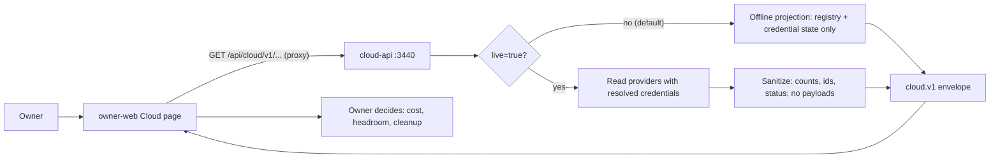
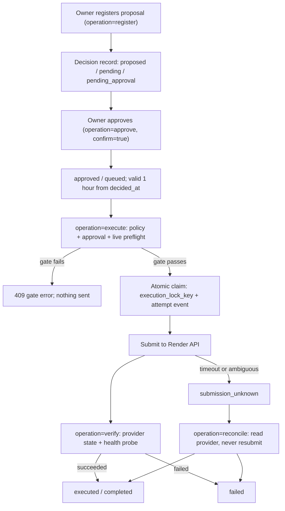

# 01 — Business process (As-Is / To-Be)

`platform-cloud-api` (service name `solo-empire-cloud-api`) เป็น **local admin API** ของ owner: รวม usage / free-quota / billing / inventory ของ cloud และ PaaS providers เป็น projection แบบ sanitized เดียว และรัน Render actions ชุดเล็กที่ผ่าน governance (proposal → owner approval → live preflight → execute → verify) โดย credential ไม่เคยเข้า browser และไม่คืน provider payload ([PRODUCT.md](../../PRODUCT.md))

## As-Is (จาก code วันนี้)

### A. ดูการใช้งาน cloud (read path)

### B. Governed Render action (write path)

Sources: `PRODUCT.md`, `README.md`, `server.py` (`CloudApi.handle`, `_command`), `adapters/paas_execute.py` (`dispatch`, `approve`, `execute`, `verify`, `reconcile`), `adapters/paas_action.py` (`register_proposal`, `assess_approval_row`), `registry/paas-action-policy.json`, owner-web consumer `bookchaowalit/life-dashboard-web` `lib/backends.ts`, `modules/cloud/api.ts` (local checkout `bdc4e63`, 2026-10-22)

## To-Be

ไม่มี UPGRADE-PLAN หรือ issue ใน repo; แหล่ง To-Be ที่มีคือ:

- `specs/001-l2-baseline/spec.md` (SPEC-001): L2 baseline (lock, strict mypy, Ruff, Sentry, rule tests) **implemented แล้ว** แต่ review 2026-10-24 = changes requested (ตาราง §4 เสีย) และรอ owner approve
- `DOCPACK/00-product-card.md` §8: "ตัดสินใจว่าจะ deploy เป็น cell ออนไลน์หรือคง local" และ "sync check ระหว่าง `adapters/` กับต้นฉบับ"

## Open questions

- To-Be ของกระบวนการ: คง local หรือขึ้นเป็น hosted cell (product card §8)? ถ้า hosted ต้องย้าย command boundary (loopback-only) อย่างไร
- owner รีวิว free-quota / billing บ่อยแค่ไหน (PRODUCT.md Measures = [ต้องยืนยัน])
- การ reject proposal ทำผ่าน decision-cli (`next_action` ใน `paas_action.py`) ไม่ได้อยู่ใน API นี้: ยืนยันว่าเป็น flow จริง
