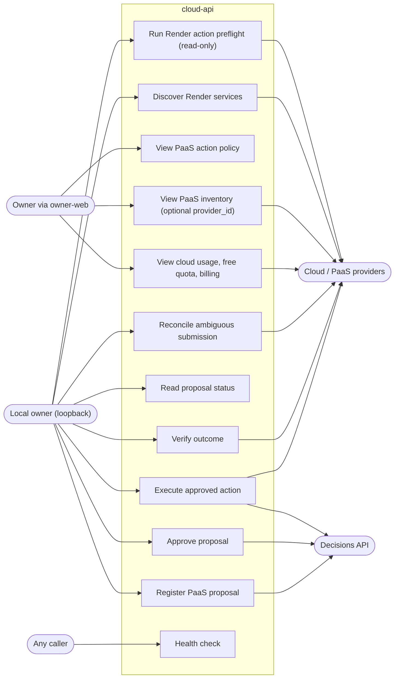

# 02 — Use cases

Actors = roles / auth levels ที่ code แยกจริง:

- **Owner via owner-web** (browser, CORS origin `http://localhost:3400` / `http://127.0.0.1:3400`, bearer `CLOUD_API_TOKEN` เมื่อตั้ง) — owner-web proxy อนุญาตแค่ `GET` ของ `v1/cloud/usage`, `v1/paas/inventory`, `v1/paas/actions`
- **Local owner** (loopback peer + allowed local Origin + `X-Solo-PaaS-Command: 1` + JSON + token ถ้าตั้ง) — `POST /api/v1/paas/commands`
- **Any caller** — `GET /health` ไม่ต้อง auth
- **Automation identities** ที่ adapter ใช้ไปหา decisions API: `paas-operator` (register / execute / verify / reconcile) และ `owner-cli` (approve)
- **Providers** (secondary actors): Render, Vercel, Railway, Fly.io, Heroku, Cloudflare, GitHub, Neon, Supabase, Upstash, RunPod

หมายเหตุ: UC4/UC5 เป็น GET read routes (ใช้ `_require_read_auth` เหมือน UC1–UC3) แต่ owner-web allowlist ไม่ได้รวมไว้ จึงเรียกได้จาก local caller (เช่น curl) เท่านั้นในทางปฏิบัติ

Sources: `server.py` (`_authorized`, `_require_read_auth`, `_owner_gate`, `COMMAND_OPERATIONS`, `handle`), `adapters/paas_execute.py` (`connection` → `paas-operator`, `approve` → `owner-cli`), `adapters/paas_action.py` (`register_proposal`), `registry/cloud-providers.yaml`, owner-web `lib/backends.ts` (cloud entry)

## Open questions

- มี client อื่นนอกจาก owner-web ที่เรียก read routes ไหม (เช่น MCP หรือ CLI)?
- UI สำหรับ PaaS commands อยู่ที่ไหน: owner-web allowlist ไม่มี `POST` ของ cloud — เรียกด้วยมือ/สคริปต์?
