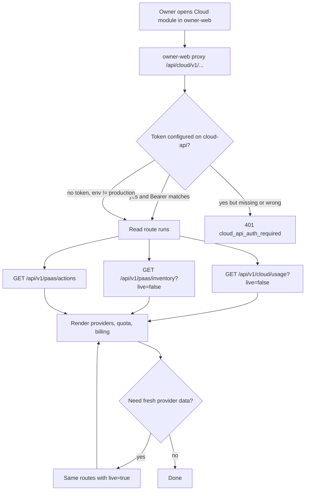
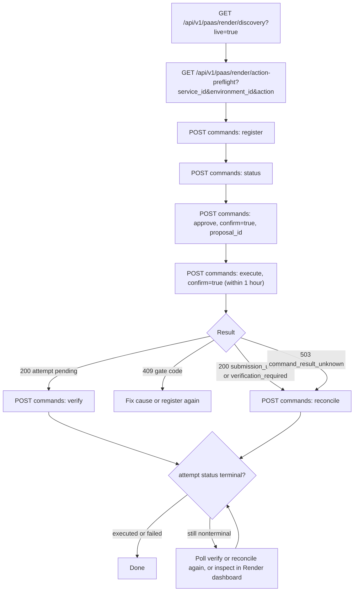
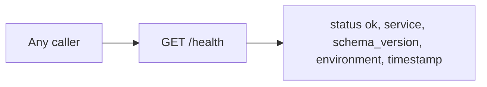

# 03 — User flows

ไม่มี UI ใน repo นี้ (API only, `PRODUCT.md` Platform = api) flow ด้านล่างจึงเป็น journey ระดับ request ต่อ role จาก routes ใน `server.py`

## Flow 1 — Owner ดู Cloud page ใน owner-web

## Flow 2 — Local owner รัน Render action

## Flow 3 — Health check

Sources: `server.py` (`handle`, `_command`, `_render_discovery`, `_render_preflight`, `_owner_gate`), `adapters/paas_execute.py` (`dispatch`), `README.md` (Run), owner-web `modules/cloud/api.ts`, `lib/backends.ts`, `app/api/[service]/[...path]/route.ts`

## Open questions

- owner-web เคยเปิด `live=true` จาก UI หรือไม่ และกดเมื่อไร (`modules/cloud/api.ts` รับ `live` เป็น parameter)
