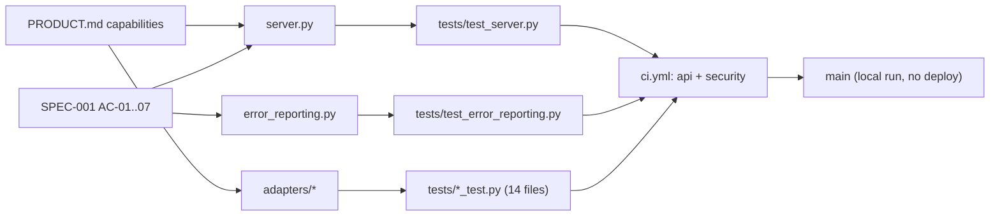

# 04 — Traceability (RTM)

Requirements มาจาก `PRODUCT.md` (Capabilities and Constraints) และ `specs/001-l2-baseline/spec.md` (AC-01..AC-07) "Release" ของ repo นี้ = merge/push เข้า `main` ที่ผ่าน `.github/workflows/ci.yml` (ไม่มี deploy, run local ด้วย `python3 server.py`)

| ID | Requirement | Code module | Test file | Release / workflow |
|---|---|---|---|---|
| P-01 | `GET /health` without auth | `server.py` `CloudApi.handle` | `tests/test_server.py` (`test_health_is_available_without_authentication`) | `ci.yml` job `api` |
| P-02 | Cloud usage projection, offline by default, `?live=true` explicit | `server.py` `_cloud_usage`; `adapters/cloud_usage.py`, `cloudflare_r2_usage.py`, `vercel_billing.py`, `github_actions_usage.py`, `free_quota.py` | `tests/cloud_usage_test.py`, `cloudflare_r2_usage_test.py`, `vercel_billing_test.py`, `github_actions_usage_test.py`, `free_quota_test.py`, `test_server.py` | `ci.yml` `api` |
| P-03 | PaaS inventory (Vercel, Render, Railway, Fly.io, Heroku + read adapters) | `adapters/paas_inventory.py`, `paas_health.py`, `cloud_read_adapters.py` | `tests/paas_inventory_test.py`, `paas_control_plane_test.py`, `cloud_read_adapters_test.py` | `ci.yml` `api` |
| P-04 | Action policy route | `adapters/paas_action.py` `load_policy`; `registry/paas-action-policy.json` | `tests/paas_action_policy_test.py` | `ci.yml` `api` |
| P-05 | Render discovery and read-only preflight | `adapters/render_preflight.py` | `tests/render_preflight_test.py` | `ci.yml` `api` |
| P-06 | Command boundary: loopback, local Origin, marker header, JSON ≤ 16 KiB, no forwarding headers, token | `server.py` `_owner_gate`, `_json_body`, `RequestHandler._dispatch` | `tests/test_server.py` (`test_command_requires_local_owner_boundary`, `test_command_rejects_forwarded_headers_and_oversized_body`) | `ci.yml` `api` |
| P-07 | Proposal binding, approval ≤ 1 h, confirmation, live preflight, execution lock | `adapters/paas_execute.py`, `paas_action.py`, `decision_store.py` | `tests/paas_execute_test.py` (36 tests) | `ci.yml` `api` |
| P-08 | Only `render-v1` executes; redirects refused on authenticated requests | `registry/paas-action-policy.json`; `paas_execute.py` (`redirect_request`), `render_preflight.py` | `tests/paas_execute_test.py` (`test_disabled_policy_has_no_external_calls`), `render_preflight_test.py` (`test_redirects_are_blocked_without_requesting_location`) | `ci.yml` `api` |
| P-09 | Safe errors: 409 gate, 400 invalid, 503 `command_result_unknown`, 500 `internal_error` | `server.py` `_command`, `handle` | `tests/test_server.py` (`test_command_gate_errors_are_safe`), `test_error_reporting.py` | `ci.yml` `api` |
| P-10 | Non-loopback or production bind fails closed without token | `server.py` `serve`, `_authorized` | `tests/test_server.py` (`test_production_without_token_fails_closed`, `test_configured_token_protects_read_routes`) | `ci.yml` `api` |
| P-11 | Credentials resolved via Infisical / Vault / env, never returned | `adapters/secret_resolver.py`, `auth_resolver.py`, `_env.py` | `tests/auth_resolver_test.py` | `ci.yml` `api` |
| P-12 | Provider registry is read-only source of truth | `registry/cloud-providers.yaml`, `adapters/cloud_providers.py` | `tests/cloud_provider_registry_test.py` | `ci.yml` `api` |
| AC-01..05 | Sentry opt-in, errors only, scrubbed | `error_reporting.py` | `tests/test_error_reporting.py` (`SentryInitTest`, `ScrubTest`) | `ci.yml` `api` |
| AC-06..07 | Ambiguous command → 503 + capture; unexpected → 500 + capture | `server.py` `_command`, `handle` | `tests/test_error_reporting.py` (`ApiReportsUnexpectedErrorsTest`) | `ci.yml` `api` |
| NFR | Locked install, Ruff, strict mypy, coverage ≥ 61 % | `uv.lock`, `ruff.toml`, `pyproject.toml` | CI itself | `ci.yml` `api` (shared `ci-python.yml` v1.1.1) |
| NFR | Secret / SAST / dependency scans | — | — | `ci.yml` `security` (gitleaks, semgrep, osv-scanner, trivy-fs) |
| NFR | UTF-8 output on Windows code pages | `adapters/platform_output.py` | `tests/windows_utf8_output_test.py` | `ci.yml` `api` |

Sources: `PRODUCT.md`, `specs/001-l2-baseline/spec.md`, `server.py`, `error_reporting.py`, `adapters/*.py`, `registry/*`, `tests/*.py`, `.github/workflows/ci.yml`, `pyproject.toml`

## Open questions

- SPEC-001 ยังรอ owner approve และ §4 Interfaces ต้อง regenerate (review 2026-10-24)
- PRODUCT.md Measures (providers live success rate, `command_result_unknown` count) ไม่มี code/test ที่วัด: ใครเก็บ?
