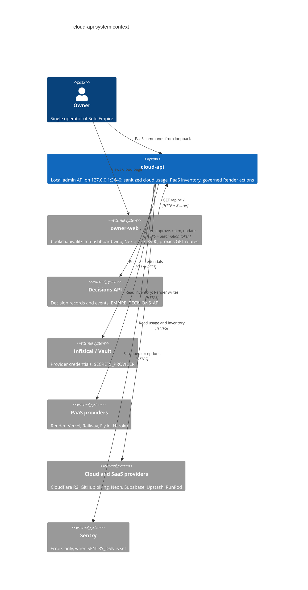

# 05 — C4 Context

Sources: `server.py`, `error_reporting.py`, `adapters/decision_store.py`, `adapters/secret_resolver.py`, `adapters/paas_inventory.py`, `adapters/cloud_read_adapters.py`, `adapters/cloudflare_r2_usage.py`, `adapters/github_actions_usage.py`, `adapters/vercel_billing.py`, `adapters/paas_execute.py`, owner-web `lib/backends.ts`

## Open questions

- Decisions API ที่ใช้จริงบนเครื่อง owner เป็น hosted cell หรือ local (ค่า `EMPIRE_DECISIONS_API` อยู่นอก repo)
