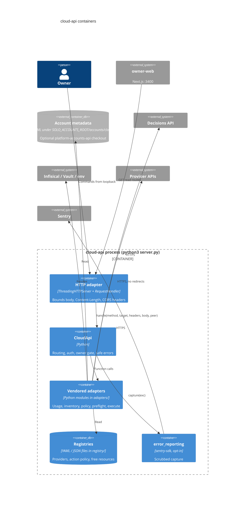

# 06 — C4 Container

Sources: `server.py` (`CloudApiServer`, `RequestHandler`, `CloudApi`), `adapters/`, `registry/`, `error_reporting.py`, `adapters/cloud_usage.py` (`ACCOUNTS_REPO`), `README.md`

ไม่มี Dockerfile หรือ container image: "container" ในที่นี้คือหน่วย runtime ภายใน process เดียว (`PRODUCT.md`: no Dockerfile, no deploy target)
