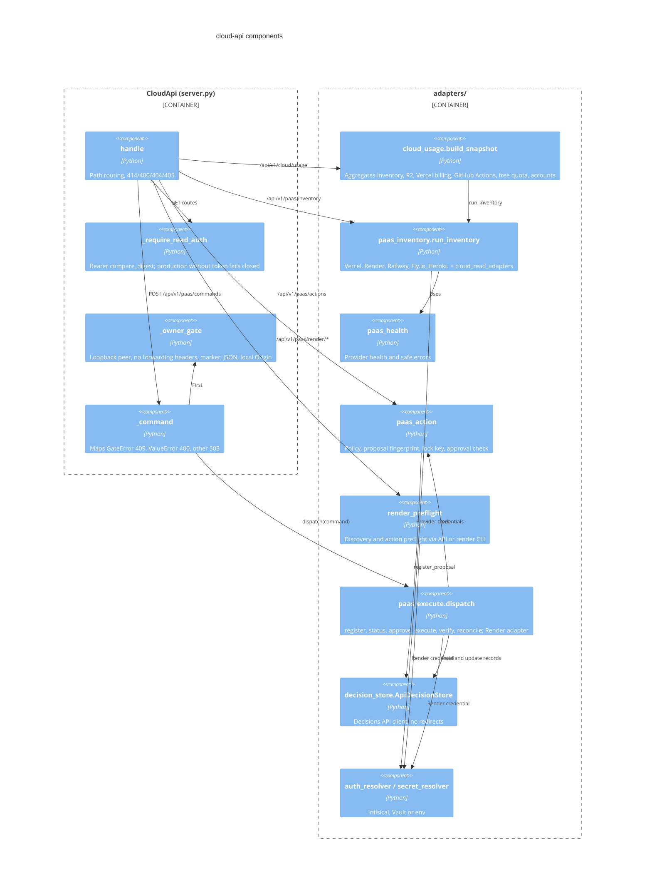

# 07 — C4 Component

Sources: `server.py`, `adapters/cloud_usage.py` (imports), `adapters/paas_inventory.py` (`INVENTORIES`, `run_inventory`), `adapters/paas_execute.py` (imports, `Render`, `dispatch`), `adapters/paas_action.py`, `adapters/render_preflight.py` (`SOURCES = {"api", "cli"}`, `_run_cli`), `adapters/decision_store.py`, `adapters/auth_resolver.py`, `adapters/secret_resolver.py`
