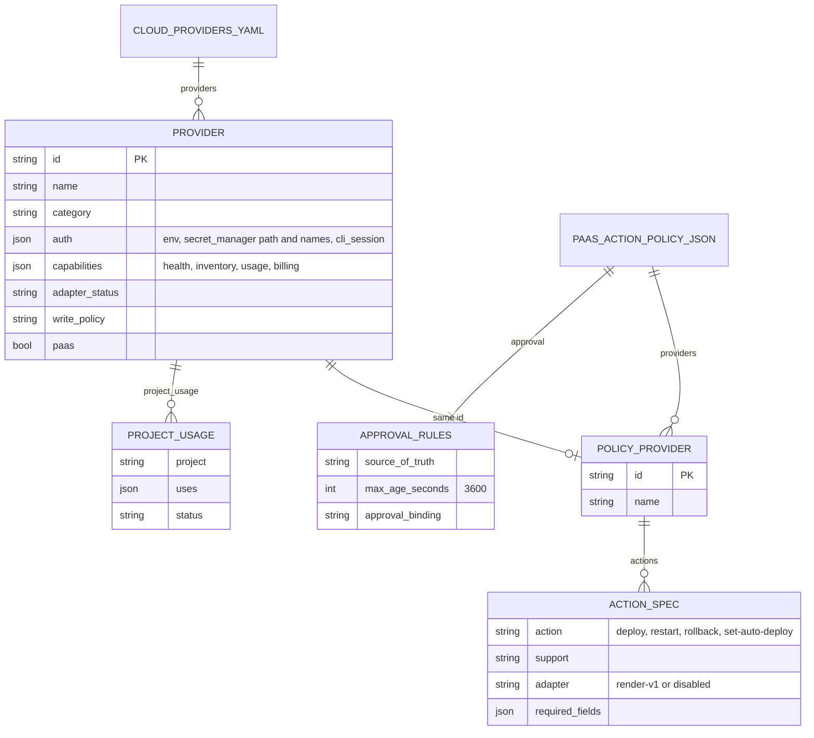

# 09 — ERD

Service นี้ **ไม่มี database ของตัวเอง** ข้อมูลที่ persist มี 3 แบบ:

1. **Decision records / events** — เก็บใน decisions API (cell อื่น) service นี้เป็น client ที่อ่าน/เขียน fields ด้านล่าง (schema จริงเป็นของ decisions cell; DDL ใน repo เป็นเพียง legacy test double)
2. **Registries** — ไฟล์ใน `registry/` (read-only ที่ runtime)
3. **Account metadata** — YAML ใต้ `$SOLO_ACCOUNTS_ROOT/accounts/cloud` (optional, read-only)

## Decision model (fields ที่ code ใช้)

```mermaid
erDiagram
  DECISION_RECORDS ||--o{ DECISION_EVENTS : "history"
  DECISION_RECORDS ||--o{ DECISION_REVIEWS : "reviews"
  DECISION_RECORDS {
    int id PK
    int version "optimistic lock, expected_version"
    string title
    string domain "paas"
    string decision
    string rationale
    json evidence_refs
    float confidence
    string expected_outcome
    string actual_outcome
    string next_action
    string status "proposed, approved, completed"
    bool approval_required
    string approval_status "pending, approved"
    string action_type "external_change"
    string action_status "pending_approval, queued, blocked, executed, failed"
    string privacy_class "internal"
    string source_type "paas_action"
    string source_ref "paas-proposal fingerprint"
    string dedupe_key "paas-action fingerprint"
    string execution_lock_key "unique resource scope or null"
    datetime decided_at
  }
  DECISION_EVENTS {
    int id PK
    int decision_id FK
    string event_type "created, approved, refreshed, completed"
    string actor "paas_action, local-owner, paas_executor"
    json metadata "request on created; attempt on paas_executor"
    datetime created_at
  }
  DECISION_REVIEWS {
    int id PK
    int decision_id FK
    date due_date
    string status
  }
```

`DECISION_EVENTS.metadata` ของ actor `paas_executor` = attempt: `status` (submission_unknown / pending / verification_required / succeeded / failed), `action`, `claimed_at`, `provider_action_id`, `error_class`, `reconciled` และ recovery fields จาก preflight

## Registry document model

Sources: `adapters/paas_action.py` (`register_proposal` fields and event), `adapters/paas_execute.py` (`update`, `approve`, `execute`, `read_record`), `adapters/decision_store.py` (`/v1/decisions`, `/v1/decision-reviews`, `expected_version`), `tests/support/legacy_decision_tables.sql`, `registry/cloud-providers.yaml`, `registry/paas-action-policy.json`, `registry/free-resource-index.json`, `adapters/cloud_usage.py` (`ACCOUNT_ROOT`)

## Open questions

- Schema ปัจจุบันของ decisions API (hosted) ตรงกับ legacy DDL แค่ไหน: field `version` และ uniqueness ของ `execution_lock_key` อนุมานจาก error handling (`version_conflict`, 409) ใน `paas_execute.py`
