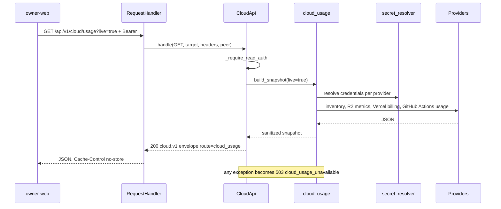
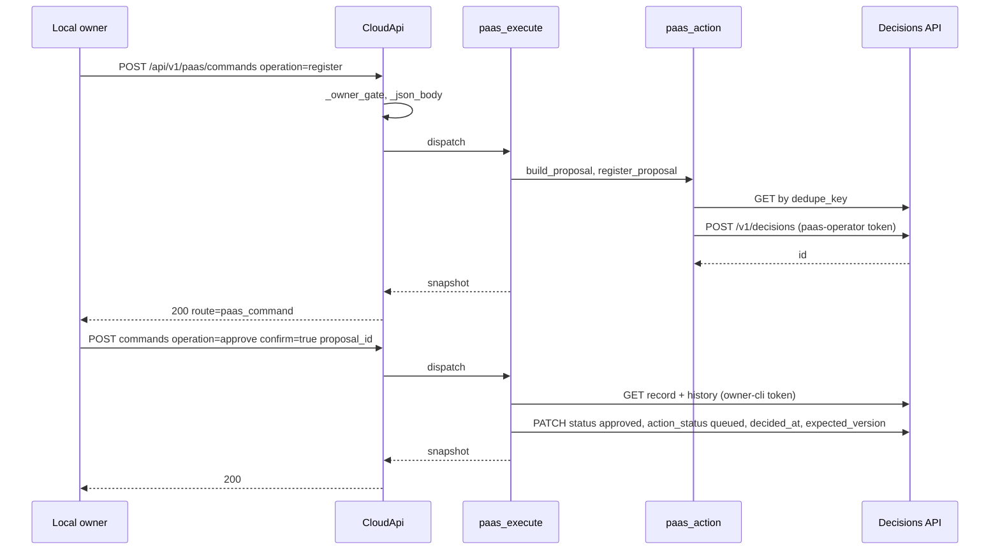
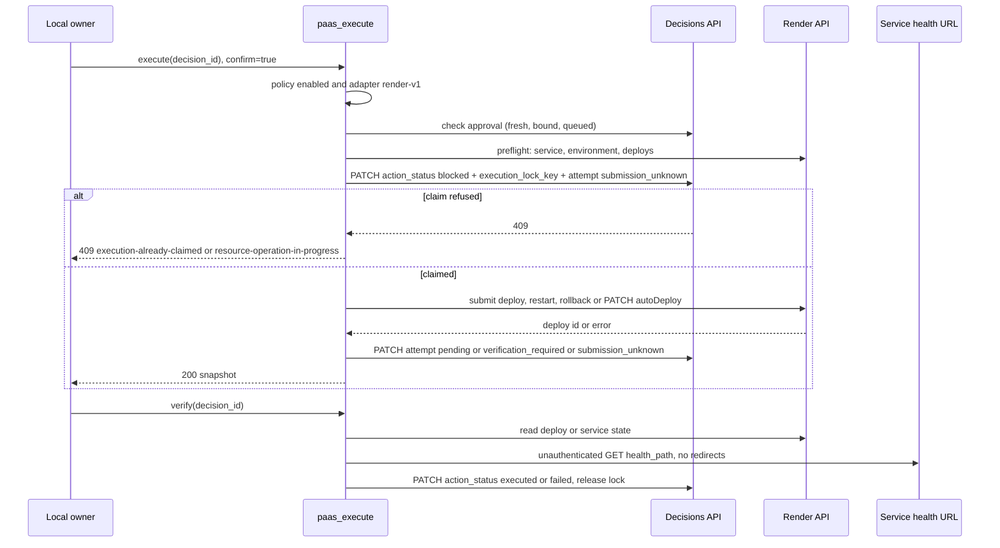
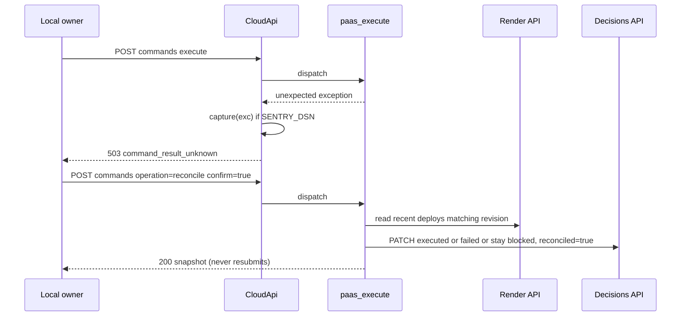

# 10 — Sequences

## 1. Cloud usage (live)

## 2. Register and approve a proposal

## 3. Execute and verify

## 4. Reconcile an ambiguous submission

Sources: `server.py` (`handle`, `_cloud_usage`, `_command`), `adapters/cloud_usage.py` (`build_snapshot`), `adapters/paas_execute.py` (`dispatch`, `approve`, `execute`, `verify`, `reconcile`, `Render`), `adapters/paas_action.py` (`register_proposal`), `adapters/decision_store.py`, `error_reporting.py`
