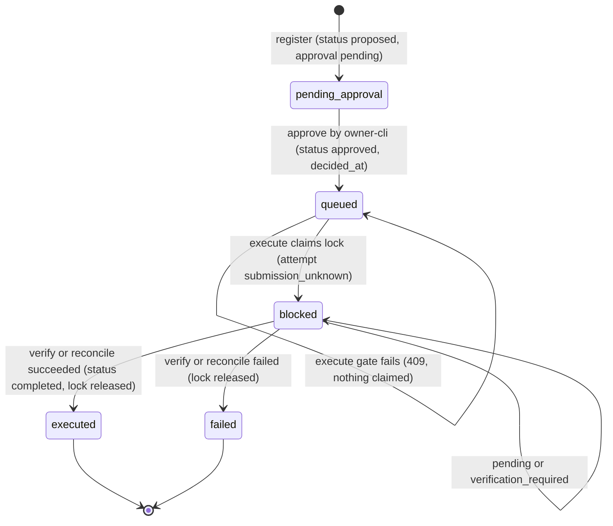
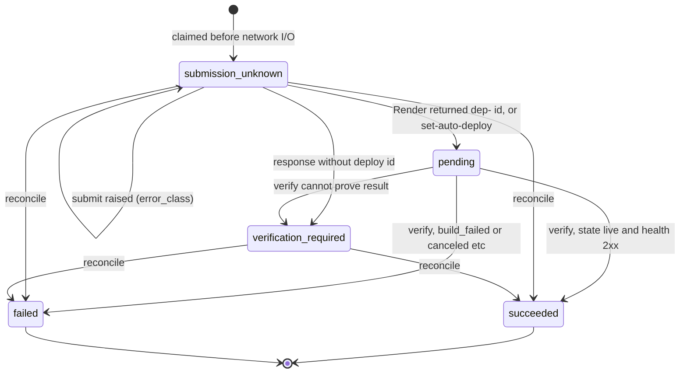

# 11 — State machines

## Decision record (PaaS) — `action_status` ร่วมกับ `status` / `approval_status`

Approval ใช้ได้ 3600 s จาก `decided_at` หลังจากนั้น execute ถูกปฏิเสธ (`assess_approval_row` `approval_fresh`) Reject / defer อยู่ใน schema แต่ไม่มี operation ใน API นี้

## Execution attempt (event metadata, actor `paas_executor`)

Pending นานเกิน 900 s → `verification-timeout-check-provider` (ไม่เปลี่ยน state)

Sources: `adapters/paas_action.py` (`register_proposal`, `assess_approval_row`), `adapters/paas_execute.py` (`approve`, `execute`, `verify`, `reconcile`, `update`, `Render.verify`, `Render.reconcile`), `registry/paas-action-policy.json` (`approval`, `verification.timeout_seconds`), `tests/support/legacy_decision_tables.sql` (CHECK lists)
