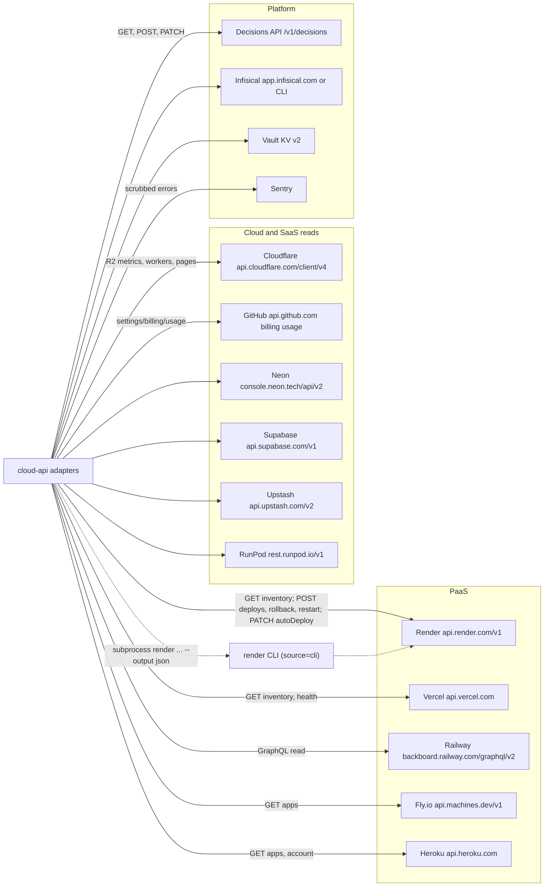

# 12 — API and integrations

Envelope contract: [`contracts/cloud.v1.json`](../../contracts/cloud.v1.json) (reused, not copied) ทุก projection มี `contract: solo-empire.cloud-api.v1` และ `route`

## Endpoints (`server.py`)

| Method | Path | Auth | Handler | Success | Errors |
|---|---|---|---|---|---|
| GET | `/health` | none | `handle` | 200 status ok | — |
| OPTIONS | any | none | `handle` | 204 | — |
| GET | `/api/v1/cloud/usage?live=` | read auth | `_cloud_usage` → `cloud_usage.build_snapshot` | 200 route `cloud_usage` | 400 `invalid_live`, 401, 503 `cloud_usage_unavailable` |
| GET | `/api/v1/paas/inventory?live=&provider_id=` | read auth | `_inventory` → `paas_inventory.run_inventory` | 200 `paas_inventory` | 401, 503 `paas_inventory_unavailable` |
| GET | `/api/v1/paas/actions` | read auth | `_actions` → `paas_action.load_policy` | 200 `paas_actions` | 401, 503 `paas_action_policy_unavailable` |
| GET | `/api/v1/paas/render/discovery?live=&source=&service_id=&environment_id=&limit=` | read auth | `_render_discovery` → `render_preflight.discover` | 200 `render_discovery` | 400 `invalid_render_request`, 503 |
| GET | `/api/v1/paas/render/preflight`, `/action-preflight` (`service_id`, `environment_id` required; `action`, `environment`, `target_deploy_id`, `target_revision`, `auto_deploy`, `health_path`) | read auth | `_render_preflight` → `render_preflight.action_preflight` | 200 `render_preflight` | 400, 503 |
| POST | `/api/v1/paas/commands` body `{operation, ...}`; operation ∈ register, status, approve, execute, verify, reconcile | owner gate + token | `_command` → `paas_execute.dispatch` | 200 `paas_command` | 400, 403, 409 gate code, 411, 413, 415, 503 `command_result_unknown` |
| any other | — | — | — | — | 404 `route_not_found`, 405, 414, 500 `internal_error` |

## External integrations

Render write surface (เท่านั้น): `POST /services/{id}/deploys` (`commitId`), `POST /services/{id}/rollback` (`deployId`), `POST /services/{id}/restart`, `PATCH /services/{id}` (`autoDeploy`) — ทั้งหมดหลัง approval + live preflight; health probe ต้องเป็น `https://<name>.onrender.com` ที่ provider ให้มา

ไม่มี webhook ขาเข้า

Sources: `server.py`, `contracts/cloud.v1.json`, `adapters/paas_execute.py` (`API`, `Render.submit`, `health_url`), `adapters/paas_inventory.py`, `adapters/paas_health.py`, `adapters/cloud_read_adapters.py` (`READ_PROVIDERS`, base URLs), `adapters/cloudflare_r2_usage.py`, `adapters/github_actions_usage.py`, `adapters/vercel_billing.py`, `adapters/render_preflight.py` (`_run_cli`), `adapters/secret_resolver.py`, `adapters/decision_store.py`, `error_reporting.py`, `registry/paas-action-policy.json`
