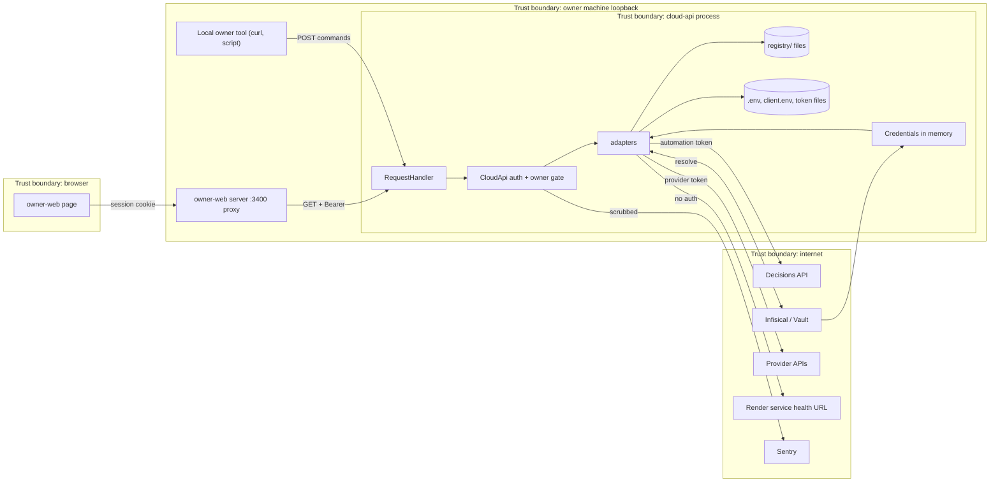

# 13 — Threat model (DFD + STRIDE)

## STRIDE per element

| Element | Threat | Existing mitigation (code) | Gap |
|---|---|---|---|
| HTTP adapter | **D**oS: big or chunked bodies, long targets | `MAX_BODY_BYTES` 16 KiB, 411 on non-identity `Transfer-Encoding`, `MAX_TARGET_CHARS` 4096 (`server.py`) | ThreadingHTTPServer ไม่มี rate limit / timeout ต่อ connection |
| Read routes | **S**poofing / **I**nfo disclosure | Bearer `compare_digest` when `CLOUD_API_TOKEN`; production or non-loopback without token refuses to start (`serve`) | ไม่มี token → อ่านได้จาก process ใดก็ได้บน loopback (dev default) |
| Command route | **S**poofing / CSRF from a browser page | loopback peer, `Host` loopback, Origin in allowlist + http + no userinfo, `X-Solo-PaaS-Command: 1` (forces CORS preflight), `application/json`, reject `Forwarded` / `X-Forwarded-*` (`_owner_gate`) | DNS-rebinding กัน Host แล้ว; local malware ที่ปลอม header ได้ไม่ถูกกันเมื่อไม่ตั้ง token |
| Command route | **T**ampering: changed proposal after approval | fingerprint binding `source_ref`, `require(stored == request)`, `reviewed-proposal-mismatch` (`paas_execute.py`) | — |
| Command route | **R**epudiation | decision events carry `actor` (`paas_action`, `local-owner`, `paas_executor`) and attempt metadata; `X-Correlation-Id` per store | log ของ server พิมพ์แค่ method + path (`log_message`), ไม่มี audit log ในตัว |
| Execute | **E**levation: run without approval / stale approval / double submit | approval valid + ≤ 3600 s, explicit `confirm`, policy `execution_enabled` + adapter `render-v1`, atomic claim with `expected_version` + `execution_lock_key`, no resubmit on unknown | approve และ execute เรียกจาก route เดียวกันได้โดย local owner คนเดียว (four-eyes ไม่บังคับ) |
| Adapters → providers | **I**nfo disclosure: token sent to other host | `_NoRedirect` handlers (`task_store.py`, `cloud_read_adapters.py`, `paas_execute.py`), https-only decisions URL (http only loopback) | gap: live inventory reads in `paas_inventory.py` use `_get_json` / `_post_json` from `paas_health.py`, plain `urllib.request.urlopen`, which follows redirects and may carry `Authorization` to another host |
| Health probe | **S**SRF via `health_path` / host | host must match `https://[a-z0-9-]+.onrender.com`, path cleaned and bounded, redirects blocked (`render_preflight.py`, `paas_execute.py` `health_url`) | — |
| Responses | **I**nfo disclosure: payloads, tokens, tracebacks | sanitized projections, `_safe_error_code`, generic 500/503, `Cache-Control: no-store` | — |
| Credentials | **I**nfo disclosure | in-memory only (`secret_resolver` docstring), `include_local_variables=False` in Sentry, client file refused if group/world readable (`task_store.py` docstring) | `.env` ที่ root โหลดเข้า env (`_env.load_env`) — permission ไม่ถูกตรวจ |
| Sentry | **I**nfo disclosure | `before_send=_scrub_event`, PII off, request reduced to method, logs not forwarded | — |
| Registries | **T**ampering | files in Git, CI gitleaks/semgrep/osv/trivy | registry ถูกอ่านจาก working tree ตอน runtime ไม่ได้ verify hash |

Sources: `server.py`, `error_reporting.py`, `adapters/paas_execute.py`, `adapters/paas_action.py`, `adapters/render_preflight.py`, `adapters/task_store.py`, `adapters/decision_store.py`, `adapters/cloud_read_adapters.py`, `adapters/secret_resolver.py`, `adapters/_env.py`, `.github/workflows/ci.yml`, `tests/test_server.py`, `tests/render_preflight_test.py`

## Open questions

- บนเครื่อง owner ตั้ง `CLOUD_API_TOKEN` หรือไม่ (ถ้าไม่ตั้ง read routes เปิดให้ทุก process บน loopback)
- ต้องการแยกคน approve กับคน execute ไหม (ตอนนี้ owner คนเดียวทำทั้งสองผ่าน route เดียว)
