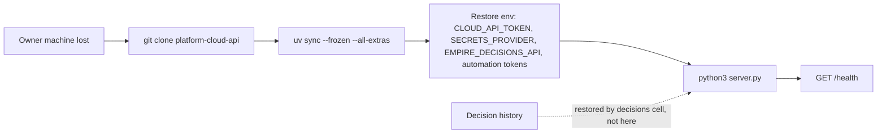

# 14 — Backup / DR

| Data | Where it lives | Owner | Backup / restore reality |
|---|---|---|---|
| Source, registries, contract | GitHub `bookchaowalit/platform-cloud-api` (public) + local clone | this repo | Git history is the backup; restore = `git clone` + `uv sync --frozen --all-extras` |
| PaaS decision records and events | Decisions API (`EMPIRE_DECISIONS_API`) | decisions cell, not this repo | ไม่อยู่ใน repo นี้; ดู backup ของ decisions cell |
| Account metadata | `$SOLO_ACCOUNTS_ROOT/accounts/cloud/*.yaml` (platform-accounts-api checkout) | platform-accounts-api | Git of that repo |
| Provider credentials | Infisical / Vault / env | secrets hub | นอก repo |
| Runtime state of cloud-api | none (stateless process; snapshots are computed per request) | — | nothing to back up |

- RTO / RPO: **not defined** (ไม่มีใน repo หรือ PRODUCT.md)
- ไม่มี backup workflow ใน `.github/workflows/` (มีเพียง `ci.yml`)
- PaaS command ที่ค้าง `blocked` + `execution_lock_key` หลัง crash: กู้ด้วย `operation=reconcile` (อ่าน provider) ไม่ใช่ restore

Sources: `README.md`, `PRODUCT.md`, `.github/workflows/ci.yml`, `adapters/decision_store.py`, `adapters/cloud_usage.py` (`ACCOUNT_ROOT`), `adapters/task_store.py` (client.env, token dir), `adapters/paas_execute.py` (comment "A crash … leaves a durable claim")

## Open questions

- RTO / RPO สำหรับ cloud-api (local tool) ต้องกำหนดไหม หรือยอมรับว่า "re-clone"
- Backup / restore drill ของ decisions API ครอบ `decision_records` domain `paas` หรือไม่ (นอก repo)
