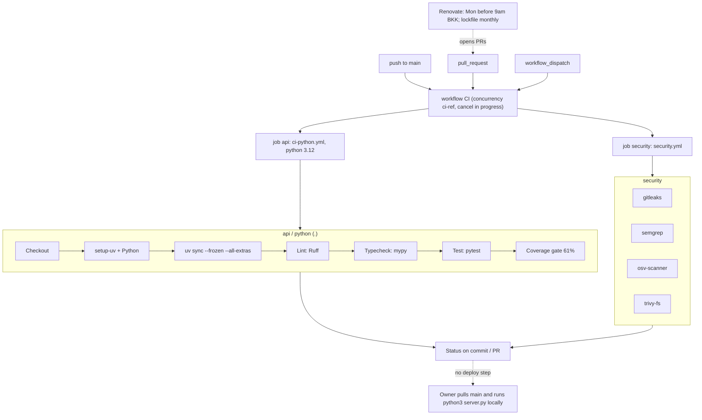

# 15 — CI/CD pipeline

CI เท่านั้น ไม่มี CD (ไม่มี deploy job / deploy config) Workflow เดียว `.github/workflows/ci.yml` เรียก reusable workflows จาก `bookchaowalit/platform-ci-workflows` pin SHA `87dc5e1` (v1.1.1) บน GitHub-hosted runners (repo public)

ผลล่าสุด run `40084274005` (push `be8ce1a`, 2026-10-24): `api / python (.)`, `security / gitleaks`, `security / trivy-fs`, `security / osv-scanner`, `security / semgrep` = success

Sources: `.github/workflows/ci.yml`, `platform-ci-workflows` `ci-python.yml` and `security.yml` at `87dc5e1c7e0416886a6371d5a101bb2ccba38edd` (via `gh api .../contents`), `gh run view 40084274005 --json jobs`, `renovate.json`, `PRODUCT.md`
