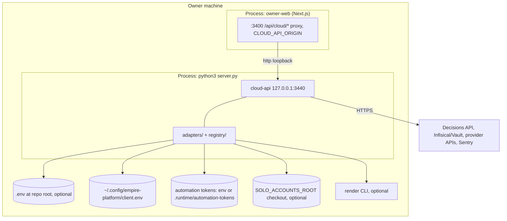

# 16 — Deployment

**ไม่มี hosted deployment**: ไม่มี Dockerfile, Railway/Vercel/Cloudflare config หรือ deploy job; `PRODUCT.md` ระบุ "Local by design (registry `online-systems.yaml`, id `cloud`, status `exception`, host `local`) … no production URL, no Dockerfile, no deploy target" diagram จึงเป็น local runtime จริงบนเครื่อง owner

| Setting | Default | Source |
|---|---|---|
| `CLOUD_API_HOST` / `CLOUD_API_PORT` | `127.0.0.1` / `3440` | `server.py` `main` |
| `CLOUD_API_CORS_ORIGINS` | `http://localhost:3400,http://127.0.0.1:3400` | `server.py` `CloudApi.__init__` |
| `CLOUD_API_ENV` | `development` | `server.py` |
| `CLOUD_API_TOKEN` | unset (required off-loopback / production) | `server.py` `serve` |
| `SECRETS_PROVIDER` | `auto` | `adapters/secret_resolver.py` |
| `EMPIRE_DECISIONS_API` | none (env or client.env) | `adapters/decision_store.py` |
| `SENTRY_DSN`, `SENTRY_ENVIRONMENT`, `SENTRY_RELEASE` | unset / `production` / none | `error_reporting.py` |
| `SOLO_ACCOUNTS_ROOT` | `<repo>/accounts` | `adapters/cloud_usage.py` |

Sources: `PRODUCT.md`, `README.md`, `server.py`, `error_reporting.py`, `adapters/secret_resolver.py`, `adapters/decision_store.py`, `adapters/task_store.py`, `adapters/_env.py`, `adapters/cloud_usage.py`, `adapters/render_preflight.py`, owner-web `lib/backends.ts`

## Open questions

- process ของ cloud-api เริ่มอย่างไรบนเครื่อง owner (manual, systemd, Task Scheduler)? ไม่มี service unit ใน repo
- จะขึ้นเป็น hosted cell หรือไม่ (product card §8)
