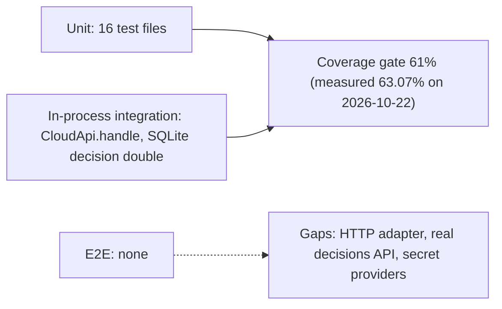

# 17 — Test coverage matrix

Levels ตามที่ test files ทำจริง:

- **unit** — function/module กับ fakes / `unittest.mock`
- **integration (in-process)** — หลาย module + test double ของ store: `paas_execute_test.py` และ `paas_action_policy_test.py` ใช้ `tests/support/sqlite_decision_store.py` (SQLite temp DB จาก `legacy_decision_tables.sql`); `test_server.py` / `test_error_reporting.py` เรียก `CloudApi.handle` ตรง (transport-independent) โดยไม่เปิด socket
- **e2e** — ไม่มี (ไม่มี test ที่เปิด `server.py` บน socket หรือเรียก provider / decisions API จริง)

| Feature | Unit | Integration (in-process) | E2E | Test files |
|---|---|---|---|---|
| Health, routing, target limit | ✓ | ✓ (`CloudApi.handle`) | ✗ | `test_server.py` |
| Read auth, production fail-closed | ✓ | ✓ | ✗ | `test_server.py` |
| Command owner gate, forwarded headers, body limit | ✓ | ✓ | ✗ | `test_server.py` |
| Safe error mapping 409 / 503 / 500 + Sentry capture | ✓ | ✓ | ✗ | `test_server.py`, `test_error_reporting.py` |
| Sentry init and scrub | ✓ | — | ✗ | `test_error_reporting.py` |
| Cloud usage snapshot | ✓ | — | ✗ | `cloud_usage_test.py` |
| Cloudflare R2 usage | ✓ | — | ✗ | `cloudflare_r2_usage_test.py` |
| Vercel billing | ✓ | — | ✗ | `vercel_billing_test.py` |
| GitHub Actions usage | ✓ | — | ✗ | `github_actions_usage_test.py` |
| Free quota projection | ✓ | — | ✗ | `free_quota_test.py` |
| PaaS inventory (5 PaaS) | ✓ | — | ✗ | `paas_inventory_test.py`, `paas_control_plane_test.py` |
| Read adapters (Neon, Cloudflare, RunPod, Supabase, Upstash) | ✓ | — | ✗ | `cloud_read_adapters_test.py` |
| Provider registry | ✓ | — | ✗ | `cloud_provider_registry_test.py` |
| Auth resolution order, CLI sessions (railway, vercel, gh) | ✓ | — | ✗ | `auth_resolver_test.py` |
| Render discovery and preflight, redirect + SSRF guards | ✓ | — | ✗ | `render_preflight_test.py` |
| Action policy, approval check | ✓ | ✓ (SQLite double) | ✗ | `paas_action_policy_test.py` |
| Execute lifecycle, claim, verify, reconcile | ✓ | ✓ (SQLite double) | ✗ | `paas_execute_test.py` |
| UTF-8 output on cp1252 | ✓ | — | ✗ | `windows_utf8_output_test.py` |
| HTTP adapter (`RequestHandler._dispatch`: 411, Content-Length, CORS headers) | ✗ | ✗ | ✗ | **gap** |
| `decision_store.ApiDecisionStore` against real HTTP | ✗ | ✗ | ✗ | **gap** (only SQLite double) |
| `secret_resolver` Infisical / Vault backends themselves | ✗ (only mocked via `auth_resolver_test.py`) | ✗ | ✗ | **gap** (no `secret_resolver_test.py`) |

Sources: `tests/*.py`, `tests/support/sqlite_decision_store.py`, `tests/support/legacy_decision_tables.sql`, `.github/workflows/ci.yml` (`coverage-threshold: "61"`), `specs/001-l2-baseline/spec.md` §6, `pyproject.toml` (`[tool.coverage.run]`)

## Open questions

- SPEC-001 review นับได้ 136 passed — ต้องการ e2e smoke (เปิด socket + `GET /health`) ใน CI ไหม
