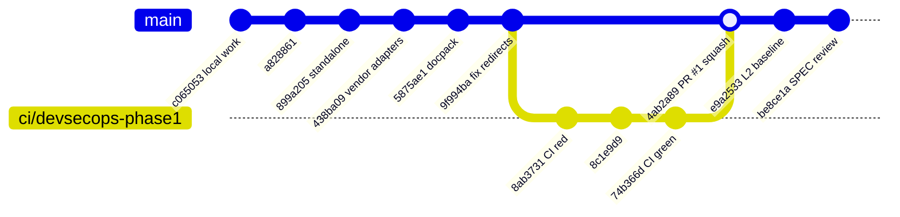
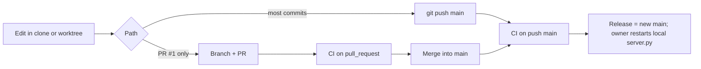

# 18 — Git / release workflow

`main` **ไม่มี branch protection** (`gh api .../branches/main/protection` → 404 "Branch not protected", ไม่มี rulesets) commits ส่วนใหญ่ push ตรงเข้า `main` มี PR เดียว (#1, squash) ไม่มี tag หรือ release

(PR #1 ถูก squash-merge; gitGraph แสดงเป็น merge เพื่อให้เห็น branch)

Sources: `git log origin/main` (at `be8ce1a`), `gh pr list -R bookchaowalit/platform-cloud-api --state all`, `gh run list -R bookchaowalit/platform-cloud-api`, `gh api repos/bookchaowalit/platform-cloud-api/branches/main/protection`, `gh api .../rulesets`, `.github/workflows/ci.yml`, SPEC-001 ("Main-only: yes")

## Open questions

- ต้องการ branch protection / required checks บน `main` ไหม (ตอนนี้ red CI ไม่บล็อก push)
- การ "release" ไปเครื่อง owner ทำอย่างไร (pull + restart) — ไม่มีบันทึกใน repo
