# 19 — Service dependency map

```mermaid
flowchart LR
  OW["owner-web :3400"] -->|"hard for Cloud page"| CA["cloud-api :3440"]
  CA -->|"hard for PaaS commands"| DEC["Decisions API"]
  CA -->|"hard for live reads and commands"| SEC["Secrets: Infisical / Vault / env"]
  CA -->|"live=true only"| PAAS["Vercel, Render, Railway, Fly.io, Heroku APIs"]
  CA -->|"live=true only"| CLD["Cloudflare, GitHub, Neon, Supabase, Upstash, RunPod APIs"]
  CA -->|"commands: execute, verify, reconcile"| RND["Render API + onrender.com health URL"]
  CA -->|"optional"| ACC["platform-accounts-api checkout (files)"]
  CA -->|"optional source=cli"| RCLI["render CLI"]
  CA -->|"optional, SENTRY_DSN"| SEN["Sentry"]
  CA -->|"build time"| PYP["PyPI via uv.lock: PyYAML, sentry-sdk"]
  CI["GitHub Actions"] -->|"reusable workflows @87dc5e1"| PCW["platform-ci-workflows"]
```

| Dependency | Type | Failure behaviour (code) |
|---|---|---|
| Decisions API | HTTPS, automation tokens `paas-operator`, `owner-cli` | URL/token missing → `ClientConfigError`; network → `DecisionStoreError(503)`; surfaced as 409 gate code or 503 `command_result_unknown` |
| Secrets provider | Infisical CLI/REST, Vault KV v2, env | provider reported `not_configured` / `error` per provider, never as zero |
| Provider APIs | HTTPS read (and Render write) | per-provider `error_class`; whole-route exception → 503 `*_unavailable` |
| Sentry | HTTPS | off without DSN |
| Account metadata | local YAML `**/account.y*ml` | path missing → no records, no error; PyYAML missing → `yaml_unavailable` |

Sources: `server.py`, `adapters/decision_store.py`, `adapters/task_store.py`, `adapters/secret_resolver.py`, `adapters/auth_resolver.py`, `adapters/paas_inventory.py`, `adapters/cloud_read_adapters.py`, `adapters/cloud_usage.py`, `adapters/paas_execute.py`, `adapters/render_preflight.py`, `error_reporting.py`, `pyproject.toml`, `.github/workflows/ci.yml`, owner-web `lib/backends.ts`

## Open questions

- Decisions API ที่ `EMPIRE_DECISIONS_API` ชี้บนเครื่อง owner คือ instance ไหน (hosted หรือ loopback) — ค่าอยู่นอก repo
