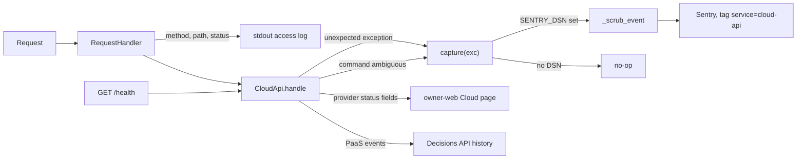

# 20 — Observability

Instrumentation ที่มีจริงใน code:

| Signal | Where | What is emitted | Watched by |
|---|---|---|---|
| Sentry errors (opt-in) | `error_reporting.py` `init_sentry`, `capture` | exceptions ที่ API แปลงเป็น 500 `internal_error` หรือ 503 `command_result_unknown`; tag `service=cloud-api`; errors only (`traces_sample_rate=None`), scrubbed | Sentry project ([ต้องยืนยัน] ว่าตั้ง DSN บนเครื่อง owner) |
| Startup line | `serve`, `init_sentry` | `solo-empire-cloud-api listening on http://host:port`; `sentry: enabled for cloud-api` (stderr) | terminal ของ owner |
| Access log | `RequestHandler.log_message` | method + path ไม่มี query ต่อด้วย `format % args` ซึ่งปกติคือ request line เต็ม จึงยังพิมพ์ query string (gap); ไม่มี body / auth | terminal ของ owner |
| Health | `GET /health` | status, service, schema_version, environment, timestamp | owner-web? ([ต้องยืนยัน]); ไม่มี uptime monitor (service เป็น local) |
| Per-provider status in payload | `cloud_usage`, `paas_inventory` | `configured` / `not_configured` / `error` + `error_class` per provider | owner บน Cloud page |
| Decision events | decisions API | `created`, `approved`, `refreshed`, `completed` + attempt metadata, `X-Correlation-Id` | decision history (`operation=status`) |
| CI | GitHub Actions `CI` | job results api + security, SARIF artifacts | GitHub notifications |

ไม่มี: metrics, tracing, PostHog, uptime worker, heartbeat, structured log shipping สำหรับ service นี้

Sources: `error_reporting.py`, `server.py` (`serve`, `log_message`, `handle`, `_command`), `adapters/cloud_usage.py`, `adapters/paas_inventory.py`, `adapters/decision_store.py` (`X-Correlation-Id`), `adapters/paas_execute.py` (`update` events), `.github/workflows/ci.yml`, `PRODUCT.md` (Operating Context, Measures)

## Open questions

- มี Sentry project / DSN สำหรับ `cloud-api` จริงไหม (PRODUCT.md [ต้องยืนยัน])
- PRODUCT.md Measures (live read success rate, จำนวน `command_result_unknown`) ยังไม่มี signal ที่นับให้
