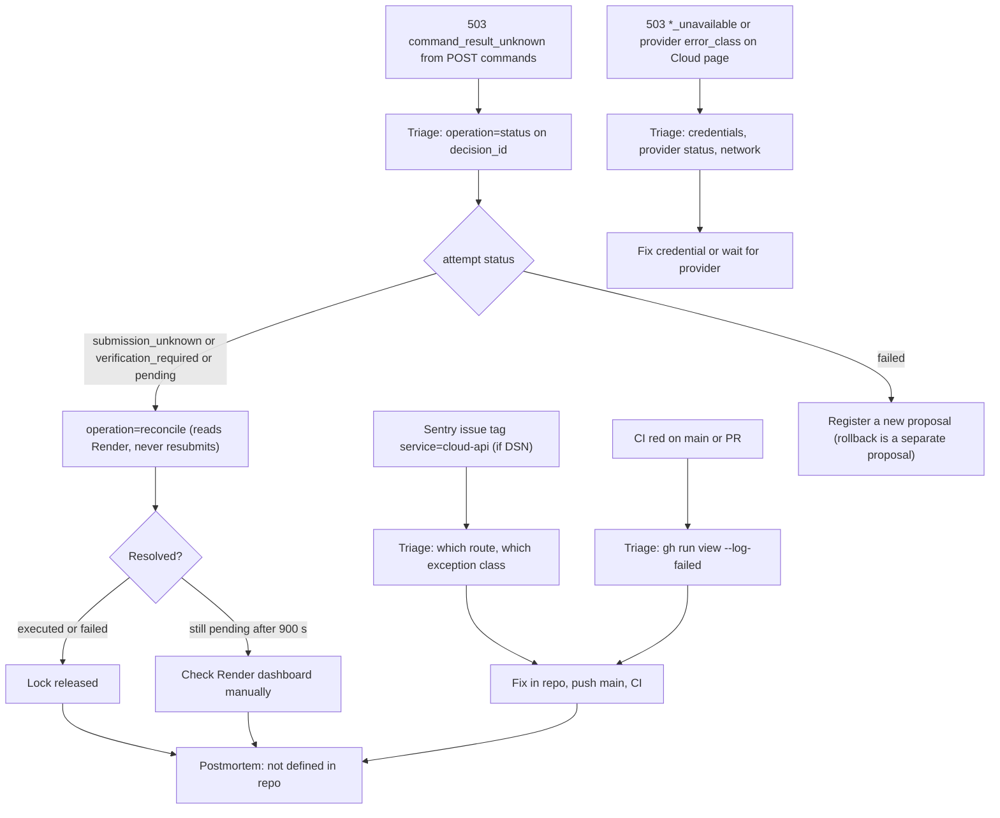

# 21 — Incident response

ไม่มี on-call / paging / Telegram alert สำหรับ service นี้ (local tool) ช่องทางสัญญาณที่มีจริงคือ: response code ที่ owner เห็นเอง, Sentry (ถ้าตั้ง DSN), และ GitHub Actions CI ผล flow ด้านล่างใช้ runbook ที่ฝังอยู่ใน code (ข้อความ "PaaS command result is unknown; inspect the decision record")

- Postmortem template / location: **not defined** (ไม่มีใน repo)
- `automatic_rollback: false`: rollback ต้องเป็น proposal ใหม่ผ่าน approval

Sources: `server.py` (`_command`, `_unavailable`), `error_reporting.py`, `adapters/paas_execute.py` (`verify`, `reconcile`, timeout 900 s), `registry/paas-action-policy.json` (`verification`), `.github/workflows/ci.yml`, `PRODUCT.md` Measures ("each needs a decision-record check")

## Open questions

- ต้องการ alert (เช่น Telegram) เมื่อเกิด `command_result_unknown` หรือไม่
- ที่เก็บ postmortem สำหรับ PaaS incidents
