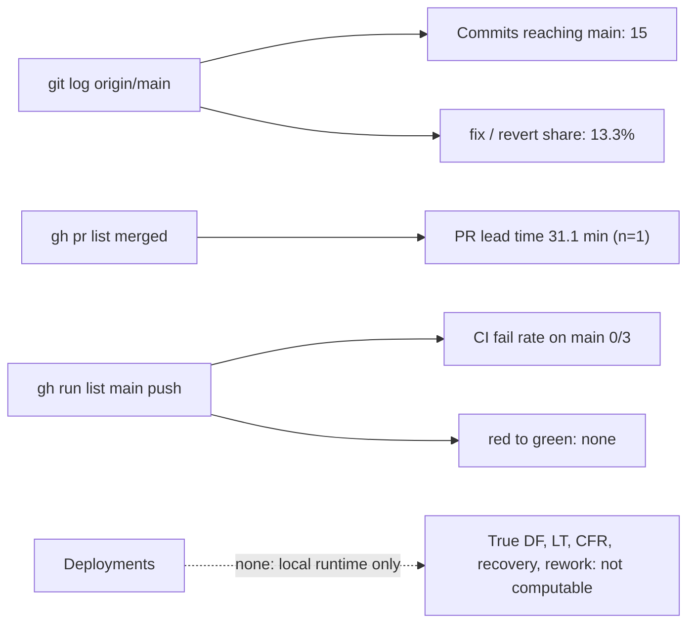

# 22 — DORA metrics

หน้าต่าง: 90 วันถึง 2026-11-04 (`--since=90.days`; commit แรก 2026-09-09 จึงครอบทั้งประวัติ) repo นี้ **ไม่มี deployment** (local tool, ADR-0001) metric ที่ผูกกับ deploy จึงวัดแท้ไม่ได้ ใช้ proxy "change reaching `main`" และ CI บน `main` GitHub Actions มี run ตั้งแต่ 2026-10-17 (CI ถูกเพิ่มใน PR #1)

| Metric | How to measure for this repo | Current value (90 d) | Command | Confidence |
|---|---|---|---|---|
| Deployment frequency | ไม่มี deploy → **cannot compute**. Proxy: commits reaching `main` | **0 deploys**. Proxy: **15 commits** on `main`, 0 merge commits (1 squash PR, 14 direct pushes) | `git log --since=90.days --oneline origin/main \| wc -l` ; `git log --since=90.days --merges --oneline origin/main \| wc -l` | proxy only |
| Lead time for changes | commit → deploy ไม่มี; proxy = PR open → merge | **31.1 min** (PR #1, n = 1); direct pushes ไม่มี lead time | `gh pr list -R bookchaowalit/platform-cloud-api --state merged -L 50 --json createdAt,mergedAt --jq '[.[]\|((.mergedAt\|fromdate)-(.createdAt\|fromdate))/60]'` | low: n = 1 |
| Change fail rate | proxy = CI failures on push to `main` | **0 / 3 = 0 %** (PR-branch run `8ab3731` failed in `api / python (.)` but never reached main) | `gh run list -R bookchaowalit/platform-cloud-api --branch main --event push -L 200 --json conclusion --jq 'group_by(.conclusion)\|map({c:.[0].conclusion,n:length})'` | low: n = 3, CI only |
| Failed deployment recovery time | ไม่มี deploy; proxy = red `main` run → next green | **cannot compute** (no red run on `main`) | `gh run list -R bookchaowalit/platform-cloud-api --branch main --event push -L 30 --json createdAt,updatedAt,conclusion,headSha` | n/a |
| Deployment rework rate | proxy = share of non-merge `main` commits whose subject starts `fix` / `revert` | **2 / 15 = 13.3 %** (`9f994ba` fix, `b4766af` revert; `ecfa10d` → revert → re-applied as `38d3fdb`) | `git log --since=90.days --no-merges --format=%s origin/main \| grep -ciE '^(fix\|revert)'` | low: commit rework, not deploy rework |

Sources: `git log origin/main` (at `be8ce1a`), `gh pr list`, `gh run list -R bookchaowalit/platform-cloud-api` (runs `39020258418` … `40084274005`), ADR-0001

## Open questions

- ถ้าจะวัด DORA แท้ ต้องนิยาม "deploy" ของ local tool (เช่น owner pull + restart พร้อม `SENTRY_RELEASE`) หรือรอการตัดสินใจ hosted cell
